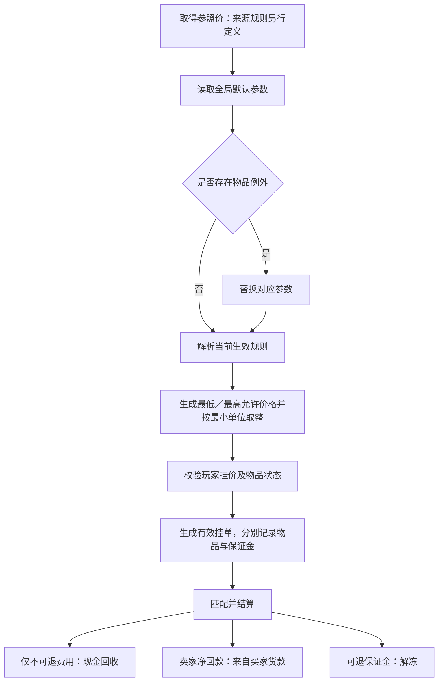

# 价格规则：个人复现模型

下图是 [[04-交易行-黑盒探测#四、个人复现模型：配置规则的一种方案]] 的实现示意，不是对官方后台架构的还原。所有费率与系数由未来设计或样本验证决定，不使用旧稿占位值充当实测。

不在图中设置已证实的“后台阴兵补货”节点。动态价格的其他解释及验证方法见 04；玩家可见流程见 [[06-交易行-流程循环]]。

## 修订记录

- 2026-11-15：改为个人复现方案，删除保证金销毁、回款增发与后台补货断言。
