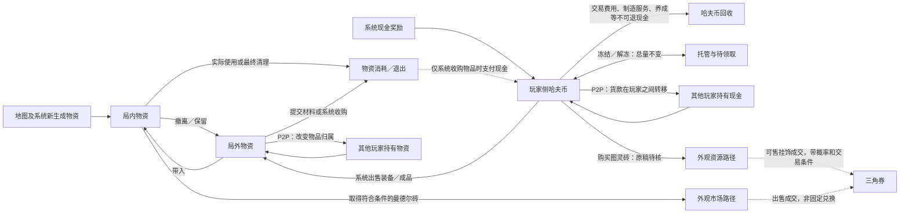

# 局内外总循环

本图同时显示物资循环与现金变化，**箭头不共用同一种核算单位**。带入／带出不是销毁，P2P 回款不是增发，可退保证金不是回收。

其中“最终清理”“系统收购”“提交材料”是不同的退出原因，仅系统收购对应支付现金；同一物品按实际原因记录。P2P 的物资与现金分别改变持有人，不能把两种账本连成新增资源。外观部分见 [[集市-资金流图]]。

关联：[[03-宏观循环-哈夫币的流动与组成]]、[[08-风险收益与保险机制]]。

## 修订记录

- 2026-11-15：修正总循环的生成、转移、现金回收与外观连接口径。
