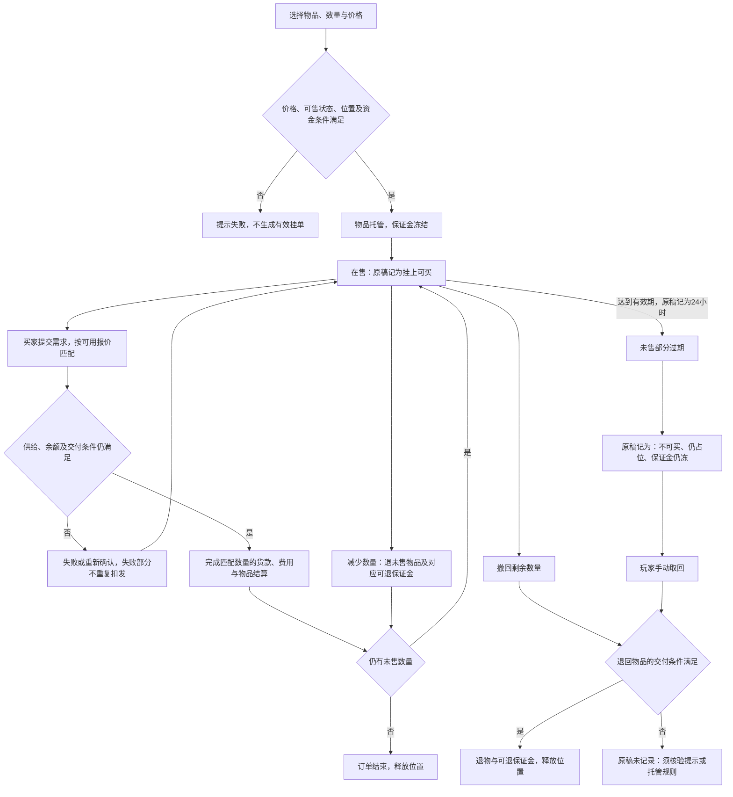

# 交易行：状态与资金流

本篇把原稿观察 O01 整理为可核验的流程。**图中校验与结算是概念模型，不代表官方后台的调用顺序、锁或事务实现。** 限价来源、完整费用、到期退款与仓库不足处理均需配套证据，见 [[13-证据索引与截图清单]]。

## 原稿时间模型

原稿记为挂上即可交易，24 小时到期后未售部分进入过期态，仍占位且保证金未解冻，手动取回后退回物品和可退保证金。售卖中只减数量，改价需撤回重挂。此处保留这组观察，不把原稿“已结案”当作附证实测。

## 流程总图

购买完成与部分成交后，费用如何分摊、对应保证金何时退还，均按实测结算记录确认。这里不以“整单成交”覆盖所有情况。

## 子流程机制说明

### 上架

可观察结果是：有效挂单进入在售，待售物品不再由玩家自由使用，可退保证金从可用余额转为冻结。价格失败、可售状态、仓位与资金不足的提示及扣款顺序，需要分别核验。

### 购买与结算

设本次成交货款为 P，最终不可退费用为 T，释放保证金为 D。在“费用从货款扣除、保证金另行退还”的模型下：

- 买家现金减少 P，取得本次成交物品。
- 卖家取得 P−T 的销售收益；D 从冻结转回可用，不计新增收入。
- 全服哈夫币净变化为 −T。
- 若收益仍待领取，则先记为卖家的待领取权益，不在领取时重复增发。

上述是核算恒等关系，不指定真实税率或实际费用扣取时点。若界面显示另一种收费方式，应按其真实流量重列账本。

### 减数量与撤回

原稿记为可减少未售数量，退对应物品与可退保证金；改价或增加货物须通过撤回重挂或新挂单完成。未售余额和已成交收益分别处理。部分成交后，释放位置取决于剩余数量是否归零，不能每次成交都释放整单位置。

### 购买竞争

多名玩家竞争同一报价时，可能出现供给变化或购买失败。本文只要求模型保证不重复扣款、不重复发物；不能由失败提示确定真实后台用了何种锁、重试或排序方式。下一报价是否自动购买、是否再次确认，仍须 E02 记录。

### 到期与取回

按原稿时间模型，到期是挂单状态变化，不自动等于保证金没收或退款。要确认“过期仍冻”，需将到期前、过期未取回、取回后三个状态的现金和物品对齐；否则只能确认订单过期，不能确认资金行为。

## 资金流视角

以下沿用原稿可退保证金模型，不填写未经附证的费率。

| 事件 | 可用现金 | 冻结／待领取权益 | 全服货币量 | 物品／位置 |
|---|---|---|---|---|
| 挂单冻结 D | 卖家 −D | 冻结 +D | 不变 | 物品托管，占位 |
| 成交 P，最终费用 T | 买家 −P；卖家按领取规则增加 | 销售收益 P−T；对应 D 释放 | −T | 成交部分转买家；余量为零才释放该单位置 |
| 减少未售数量 | 退对应可退保证金 | 相应冻结减少 | 不变，除非另有不可退费用 | 未售物品退回；有余量继续占位 |
| 到期未取回 | 原稿记为不变 | 原稿记为仍冻结 | 不因到期本身改变 | 原稿记为剩余物品挂起、仍占位 |
| 取回／撤回 | 退剩余可退保证金 | 冻结减少 | 不变，除非有明确没收或另收费用 | 退剩余物品并释放订单位置 |
| 领取销售收益 | 可用现金增加 | 同额待领取权益减少 | 不变 | 已经属于卖家的权益改变所在位置 |

> [!todo] 待补证据 E02、E03
> 至少保留一笔完整成交、一笔主动撤回、一次到期后取回的前后记录。截图应显示同一订单的单价、数量、费用、余额与状态；单笔样本不外推所有商品费率。仓库不足、部分成交与重复请求为边界待核项。

## 与其他章节对齐

- 设计影响：[[05-交易行-哈夫币机制]]。
- 价格解释与个人复现方案：[[04-交易行-黑盒探测]]。
- 全服现金核算：[[03-宏观循环-哈夫币的流动与组成#四、哈夫币的新增、销毁与冻结]]。
- 市场支付与结算：[[集市-三角币机制]]，不直接沿用此时间模型。

## 修订记录

- 2026-11-15：保留交易状态观察，修正部分成交与保证金口径；将后台锁与校验顺序改为概念模型，补齐证据边界。
