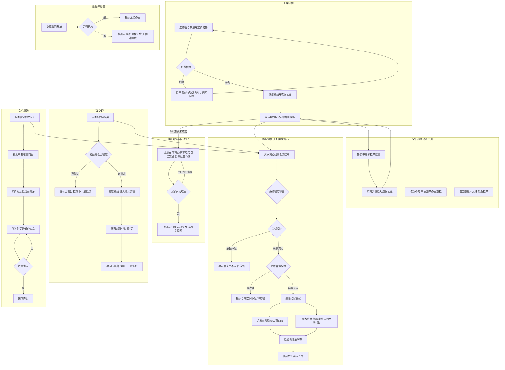

# 交易行 流程与资金流

> [!abstract] 三层定位与分工
> 本篇＝**流程与资金流层**：只讲"每一步系统做什么校验、钱和货怎么动、失败走哪条边"。不讲好/坏评价（那是 [[05-交易行-哈夫币机制]] 的事）。底层字段＝[[04-交易行-黑盒探测]]。读法：先看图建立全局，再看子流程说明逐步拆解，最后看资金流表把税/保证金/占位落成账本。

> [!info] 时间模型（已结案，无待确认项）
> 挂单后**无**独立"不可买公示期"——挂上即公示、即开卖，公示/可买窗口＝**24h**；期满进入**过期态**：不再公示、不可买，但**仍挂架占位、保证金仍冻结**，须玩家**手动取回**才退仓库＋退保证金。无拍卖，买家纯贪心扫最低价。售卖中**只减不加**，改价须整单撤回重挂。流拍/撤回无额外扣费，但过期态保证金不退还（取回才退）。

## 流程总图

> [!tip] 图的结构说明（相对原始图的全部修复，一次看清）
> 删"先不可买公示期、再售卖期、流拍自动下架"的旧三段式，合并为"公示24h即可买"单段＋"过期挂起"子图（期满不结算、挂架占位＋保证金仍冻、等手动取回）；购买流程补**卖家收款分叉**（切税 Sink＋卖家应得待领取，原始图只画买家扣款、漏了卖家到账这条与 03/05 耦合的核心边）；合并原始图冗余的"转入仓库/发送物品"两节点；补 `A3-->A1` 价格超限回边；新增**改单子图**（只减不加、改价须撤回、加货须新挂）；标注无拍卖纯贪心。回链一律放图外，图内节点保持纯流程描述。

## 子流程机制说明

> [!info] 阅读约定
> 每节只讲"状态变化＋资金流＋边界"，评价见 05 对应机制。

### 上架流程
- 状态链：选品+数量+定价+挂售→价格校验（超限回退重填，不耗资源）→冻结物品＋收保证金→**进入公示期，公示中即可被购买**，窗口 24h。
- 资金流：保证金在此**冻结而非销毁**，所有权仍属卖家，仅丧失流动性。
- 边界：无"不可买的保护性公示期"，挂上即暴露于贪心扫货之下。

### 购买流程（无拍卖）
- 性质：==无拍卖、无竞价==，买家对固定挂单用贪心算法扫最低价。
- 状态链：贪心选中→锁定→余额校验→仓库校验→扣货款→（分叉）切税＋记卖家应得→退保证金解冻→物品转买家。
- 资金流：买家扣款＝货款全额；**税切出为 Sink**（哈夫币销毁）；**货款减税＝卖家应得**，入"收益待领取"（即 03 局外资产表"邮件/收益"行来源之一，闭合 a4 边）。
- 边界：余额/仓库任一校验失败→释放锁、不扣款、不动保证金。

### 改单流程（只减不加）
- 减数量：售卖中允许，按减少量退对应保证金（部分下架正常退费），剩余继续公示售卖。
- 改价：不允许；想改价只能整单撤回后重挂新单。
- 增加数量：==不允许==，想往同一品类加货只能**另开一单**（再占一格、再冻一份保证金）。
- 不涉及任何"公示期/售卖期重置"——因挂上即开卖，无独立阶段可重置。

### 并发处理
- 状态链：A 发起→判锁→未锁则锁定并进入购买流程；B 同抢→命中"已锁"→提示并推荐下一最低价。
- 边界：锁互斥，绝不超卖；判定顺序对玩家透明为"随机/先到先得"，具体策略未验证，不影响资金流结论，故不再追。

### 贪心算法
- 状态链：需求 N 个→搜全部在售→按价升序→循环买最低价直到满足。
- 边界：低价不足自动高价补齐（超支风险，见 05 机制四）；对拆单卖家不友好，其高价单卖不掉→最终过期挂起。

### 过期挂起（取代旧"流拍"）
- 状态链：公示 24h 期满未成交→**过期态**：不再公示、不可购买，但**单子仍挂架占位、保证金仍冻结**→等玩家手动取回→退仓库＋退保证金（无额外扣费）；不取回则持续挂着、持续冻钱。
- 连锁后果：过期死单**同时占一格＋冻一份保证金**，与 05 机制三位置限制叠加＝对不清理者的"仓位＋流动资金"双重惩罚。==过期态保证金仍冻结==。
- 关键区别：旧模型"流拍＝自动结算事件"，真实模型"过期＝进入挂起态、等玩家手动收尾"，**没有自动退钱退货**。

### 主动撤回整单
- 已售→不可撤回；未售→整单撤回→退仓库＋退保证金（无额外扣费）。
- 与"减数量"区别：撤回整单清空该挂单并释放上架位＋解冻保证金；减数量保留挂单、仅退部分保证金。

## 资金流视角

> 把税/保证金/占位从"流程"抽成"账本"，与 [[03-宏观循环-哈夫币的流动与组成#哈夫币]] 的哈夫币 Faucet/Sink 对齐。"上架位"列体现过期占位，"保证金"列体现过期仍冻。

| 事件 | 买家哈夫币 | 卖家哈夫币 | 官方/Sink | 物品状态 | 上架位 |
| --- | --- | --- | --- | --- | --- |
| 挂单 | 不变 | 冻结保证金 | 托管冻结 | 冻结 | 占 1 格 |
| 成交 | 扣货款全额 | 得(货款−税)，保证金解冻 | 税＝Sink 销毁 | 转买家 | 释放 |
| 减数量 | 不变 | 退减少部分保证金 | 不变 | 部分解冻退卖家 | 仍占 1 格 |
| 24h 过期 | 不变 | **保证金仍冻结** | 不变 | 仍挂起 | **仍占 1 格** |
| 手动取回/撤回整单 | 不变 | 退保证金，无扣费 | 不变 | 退卖家 | 释放 |

> [!tip] 一句话收口
> 交易行对哈夫币＝**成交即销毁一笔税（Sink）**＋**挂单即冻结一笔保证金（流动性闸）**；对产能＝**挂单即占一格、过期不取回则死占且死冻**，与位置限制叠加逼玩家管理挂单。卖家"收益待领取"经邮件/收益入口回流局外资产，闭合 03 的 a4 边。

## 回链

- 设计意图与好坏评价：[[05-交易行-哈夫币机制]]
- 底层三级配置表：[[04-交易行-黑盒探测]]
- 哈夫币 Sink/Faucet 归属：[[03-宏观循环-哈夫币的流动与组成#哈夫币]]