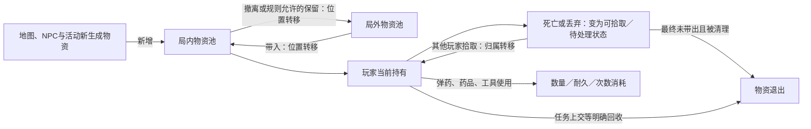

# 局内物资：生成、转移与退出

视角为服务器内的物资存量，局内与局外是位置。玩家死亡先改变物品归属与状态，不能把“死亡”和“他人拾取”同时算作销毁与新增。具体保留／回收条件待 E07 核验，见 [[13-证据索引与截图清单]]。

图不表示同一物品必然经历所有路径。队友回收、安全箱保留与无人带出，按实际结果互斥或分物品记账。

关联：[[03-宏观循环-哈夫币的流动与组成#三、局内资产：位置与归属分开]]、[[08-风险收益与保险机制]]。

## 修订记录

- 2026-11-15：改为服务器物资视角，区分新增、位置转移、归属转移与最终退出。
