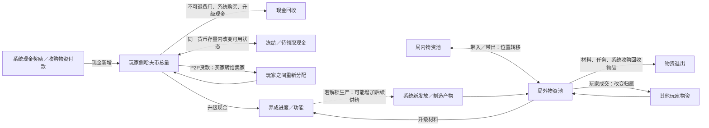

# 局外资产：现金、物资与进度分账

全服视角。不同子账之间可以发生转换，但不能直接加总为同一种 Faucet／Sink。不可逆进度单列，不作为可赎回现金。

系统收购同一次操作同时涉及“现金新增”和“物资退出”；升级也可同时涉及现金与材料回收。图中的箭头不表示一笔资源被重复算成多个同类消耗。

关联：[[03-宏观循环-哈夫币的流动与组成]]、[[07-回收与消耗系统]]。

## 修订记录

- 2026-11-15：现金、物资、冻结与进度分账；移除领取邮件和报价变化的重复新增口径。
