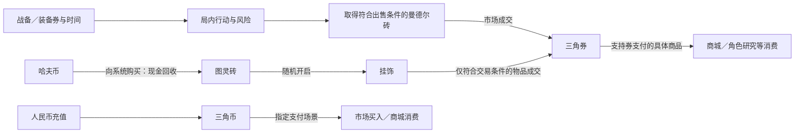

# 从玩法资源到三角券：两条原稿路径

文件名保留以维持既有链接，正文统一使用“三角券”。以下不是固定汇率兑换，也不宣称穷尽全部来源；规则证据待 E01、E06 补齐。

曼德尔砖是否自用，还须另计量子密钥；见 [[集市-资金流图]]、[[02-货币体系-三币×两市场×隔离墙#四、两条连接路径，不能称为固定兑换]]。

## 修订记录

- 2026-11-15：取消唯一通道与券可通用 P2P 的表述，补图灵砖挂饰路径。
