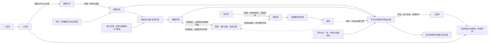

# 集市：取得、开启、交易与重组

按原稿观察与已知开启资源建立的关系图。实线表示资源路径，虚线表示待核条件或机会；每条具体支付规则以 E01、E06 为准，后续公告不倒推 S10。

哈夫币回收发生在向系统购买时；后续随机产出不影响该笔现金已被回收的分类。砖和密钥的消耗是物品消耗，不重复计为当次现金销毁。重组的产出与输入价值未必相等。

关联：[[集市-三角币机制]]、[[02-货币体系-三币×两市场×隔离墙]]、[[13-证据索引与截图清单]]。

## 修订记录

- 2026-11-15：分开砖、密钥、外观支付及卖方结算；重组改为按类型标注的待核路径。
